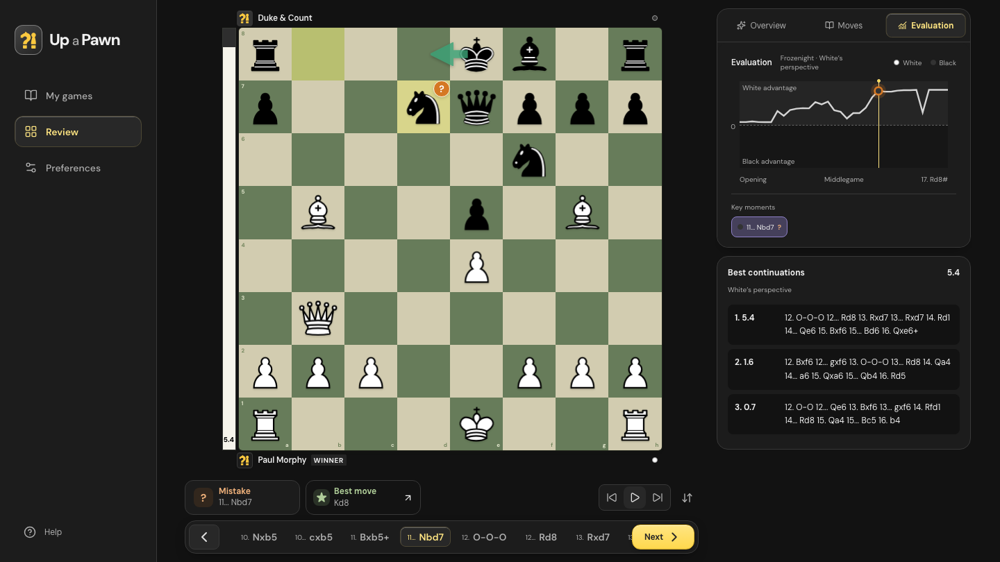

# Up a Pawn

A chess game review app for web, Android, and iOS, with on-device engine analysis and offline support.

Import a PGN, review move classifications and legal alternatives, and track evaluations throughout the game. Games and analysis stay on your device.

> **Status: early / pre-release.** Review budgets and the expected-points model are preliminary, and native behavior has not been validated on physical devices. See [Known limitations](#known-limitations).

## Product demo

[](marketing/product-overview/up-a-pawn-overview.mp4)

[Watch the 20-second overview](marketing/product-overview/up-a-pawn-overview.mp4) · [Mobile review](marketing/product-overview/mobile-best-move.png) · [PGN import](marketing/product-overview/import-pgn.png) · [Try the sample game](marketing/product-overview/opera-game.pgn)


**Check it out live at [upapawn.simonukus.com](https://upapawn.simonukus.com)**

## Features

- Local Frozenight WASM analysis with move classifications, legal alternatives, and an evaluation graph.
- PGN paste and file import, including games with custom FEN starting positions.
- A simple welcome screen before your first import, then an on-device game library with results, search, and device-local review links (`/review?game=<local-id>`).
- Move navigation, autoplay, board flip, timeline scrubbing, and move selection.
- Responsive layouts, light/dark themes, and saved board preferences.
- Offline web support and bundled native assets. No runtime asset CDN.

Keyboard shortcuts work while the page body has focus: Left/Right to navigate, Home/End to jump to the first/last move, and Space to toggle autoplay.

The move rating stays visible in a paper card below the board. When the played move was not best, a soft card beside it shows the best move. Tap that card to preview its board arrow and reveal the option to explore the line. The Analysis button opens the full review on smaller screens. Technical engine details (preliminary/refined labels, depths, nodes, and measured loss) are visible only with `?analysis=detail`.

## Run locally

Requires Node.js 22.23+, 24.22+, or 26.12+ (on the corresponding major release), and Bun 1.4+.

```sh
bun install
bun run dev
```

Open [localhost:5173](http://localhost:5173).

## Development

```sh
bun run check         # Svelte and TypeScript diagnostics
bun run test          # PGN, review scheduling, classification, and cache tests
bun run test:browser  # Chromium, Firefox, and WebKit against a production build
bun run build         # Static SPA in build/
```

`test:browser` uses Playwright. If the browsers aren't installed yet, run `bunx playwright install` first.

### Stack

- **Svelte 5, SvelteKit, TypeScript, and Vite.** Client-side rendering with `adapter-static`.
- **Bits UI.** Accessible UI primitives with component-scoped styling.
- **Capacitor 8.** Checked-in Android and iOS projects sharing the web build and routes.
- **chess.js.** PGN parsing and legal position replay.
- **chess-engine-kit.** Prebuilt Frozenight WASM engine and module worker (version pinned in `package.json`).

Fonts, icons, and chess pieces are bundled locally. For static web hosting, rewrite unknown application paths to `/index.html`.

### Deploy to Cloudflare

The app uses Workers Static Assets with typed `cloudflare.config.ts` configuration.
`wrangler.config.ts` points the packaging tool at the completed `build/` directory.
SvelteKit keeps `adapter-static`; no Cloudflare Vite plugin or server Worker is needed.
The Cloudflare CLI and Wrangler are pinned because the typed configuration toolchain is in beta.

```sh
bun run build       # SvelteKit static output, then the offline service worker
bun run cf:package  # Package build/ into .cloudflare/output/v0/
bun run cf:check    # Validate that deployment artifact without uploading
bun run cf:deploy   # Deploy the packaged artifact without rebuilding
```

Cloudflare commands explicitly run under Node, since the typed configuration loader
does not support the Bun runtime. Packaging uses Wrangler's experimental Build Output
command directly: `cf build` detects SvelteKit and runs Vite, which would skip our offline
build step and does not package the existing static output. Run the steps above in order;
`cf:deploy` publishes the last packaged artifact.

For local deployment, sign in with `node node_modules/cf/bin/cf auth login`, or set
`CLOUDFLARE_API_TOKEN` and `CLOUDFLARE_ACCOUNT_ID` in your shell.

For automatic deployment, create a GitHub environment named `production` under
**Settings → Environments** and configure:

- Secret `CLOUDFLARE_API_TOKEN`: a Cloudflare **Edit Cloudflare Workers** API token scoped to the target account.
- Secret `CLOUDFLARE_ACCOUNT_ID`: the target Cloudflare account ID.
- Variable `PRODUCTION_URL`: the full site URL, such as `https://up-a-pawn.<your-workers-subdomain>.workers.dev`, or your custom domain.

The existing verification workflow packages and dry-runs the Cloudflare artifact on
pull requests and pushes to `main`. After the web checks and all browser tests pass,
pushes to `main` deploy that same artifact. The deployment job references `production`,
so GitHub shows its status and the configured URL under the repository's **Deployments**.
Pull requests do not deploy or receive the Cloudflare credentials.

Cloudflare's first deployment may require configuring your account's `workers.dev`
subdomain in the dashboard. Change `worker.name` in `cloudflare.config.ts` if you want
a different Worker name, and update `PRODUCTION_URL` to match.

### Analysis and storage

Analysis prioritizes the selected position, then reviews the full game and refines uncertain positions. Reviews support pause, resume, and retry.

The engine provider is configured in `src/lib/engine/provider.ts` through `createFrozenight()`. Vite handles the SDK's worker, WASM, notices, and metadata in development and production. App developers do not need Rust, Docker, or a separate asset-copy step.

Move classifications follow [Chess.com's published expected-points bands](https://support.chess.com/en/articles/8572705-how-are-moves-classified-what-is-a-blunder-or-brilliant-etc): Best at zero loss, Excellent below 0.02, Good from 0.02, Inaccuracy from 0.05, Mistake from 0.10, and Blunder from 0.20. Lower bounds are inclusive. The engine's top move and exact score ties are Best; favorable search noise remains preliminary Excellent and triggers refinement, including improvements in mate distance. Disagreeing searches of the same move remain Uncertain.

Chess.com does not specify its fitted expected-points formula in that article. Our local estimate is `1 / (1 + exp(-cp / scale))`, from the mover's perspective, with `scale = 400 - (rating - 400) / 13`. Ratings come from each player's `WhiteElo` / `BlackElo` PGN header, clamped to 400–3000, with 1200 for missing or invalid ratings. Positive integer PGN ratings are clamped consistently with numeric input, including values outside that range. These coefficients are provisional, not calibrated to Chess.com's data. Forced winning/losing mates map to 1/0; an ambiguous mate-zero score remains Uncertain. Labels require completed, exact, same-position comparisons with depths within two plies.

Special labels use conservative local heuristics:

- **Great:** the best move is the only analyzed move that avoids a losing position or preserves a newly attainable win, based on the top two lines. Forced moves are excluded.
- **Brilliant:** a best or nearly best non-pawn sacrifice is accepted in a legal continuation, invests material in the initial exchange and keeps that investment through six plies (or an earlier game end), and keeps at least 0.45 expected points. The best unplayed alternative must not already be overwhelmingly winning. Pawn sacrifices and ordinary exchanges are excluded; shorter unfinished lines and sacrifices not accepted immediately may go unrecognized.
- **Miss:** the preceding opponent error creates a winning opportunity and the reply drops to at most 0.55 expected points. The preceding comparison must itself show the new winning opportunity, using the replying player's rating; a later search finding a win is insufficient. A previously existing win does not qualify. Refining the opponent's move also updates the reply's label, which remains preliminary while its evidence is preliminary.

Winning and overwhelmingly winning bands depend on rating (`0.75 + (rating - 400) / 26000` and `0.90 + (rating - 400) / 52000`); beginner sacrifices require one pawn of net investment, otherwise two. These definitions align with the published approach but cannot reproduce Chess.com's private model exactly. Technical review details show expected-points loss and the rating used alongside measured centipawn loss.

Analysis results are cached in IndexedDB. Cache keys include position history, engine identity, settings, review budget, and classification policy. Cached results are validated before reuse.

The web service worker caches the app shell and engine assets. Browser tests verify that another game can complete after an offline reload. Capacitor ships these assets inside the app.

Engine source, builds, parity checks, reproducibility, and engine notices are maintained in [chess-engine-kit](https://github.com/sximn/chess-engine-kit).

## Android and iOS

Native projects are included. After a UI change:

```sh
bun run cap:build:sync
bun run cap:android  # Open in Android Studio
bun run cap:ios      # Open in Xcode
```

Android requires Android Studio, the configured Android SDK, and a compatible JDK. iOS requires Xcode and its iOS SDK, plus a signing team for physical devices. The iOS project uses Swift Package Manager.

**Before distributing:** the app ID `com.simonukus.upapawn` is provisional, so change it along with the native bundle and application identifiers. Generated splash screens are still placeholders.

The app icons use the artwork from `favicon-candidate/`: web favicons, the Apple touch icon, and PWA icons are in `static/`, with their links in `src/app.html` and `static/site.webmanifest`. Android launcher and adaptive icons are in `android/app/src/main/res/` at all five densities, with the supplied dark background. The opaque 1024px iOS icon is in `ios/App/App/Assets.xcassets/AppIcon.appiconset/`. Native icon changes require a rebuild and reinstall. The optional dynamic favicon script and environment badges are not published.

Native integration lives in `src/lib/native.ts`:

- Android Back closes an open menu or dialog, then follows WebView history, then minimizes the app at the root.
- System bar styling follows the selected theme.
- Keyboard resizing, safe-area insets, and lifecycle events are handled by the shared shell.
- Autoplay pauses when the document becomes hidden.

## Known limitations

- Review quality and device performance are still being validated. Review budgets and the expected-points model are preliminary.
- Physical-device latency, memory use, energy consumption, and thermal behavior need further testing.
- iOS finger-following swipe-back is not implemented.
- Keyboard behavior, cutouts, rotation, system back, and export/download behavior still need device validation.

## Project structure

```text
src/lib/components/      ui/, app/, replay/, analysis/, and games/ components
src/lib/chess.ts         PGN parsing and legal position timeline
src/lib/state.svelte.ts  Shared state and local persistence
src/lib/native.ts        Capacitor integration
src/lib/engine/          Engine provider, review logic, cache, and diagnostics
src/lib/styles.css       Global styles entry point
src/lib/styles/          Foundation and reduced-motion defaults
src/routes/              Review, library, insights, preferences, and error pages
tests/                   Unit and production-browser verification
android/                 Native Android project
ios/                     Native iOS project
```

See [the components guide](src/lib/components/README.md) for folder responsibilities and import conventions.

## Diagnostics and verification

Runtime diagnostics are available at `/diagnostics`. Verification reports are generated in `artifacts/app-verification/`.

The Best move card previews the suggested move with an arrow and smoothly reveals its move list below it. The controls lift to make room only while the line is open; click any step to explore it. The game timeline stays anchored to the reviewed move. Next, Previous, playback, or a game move chip returns to the original game; Escape returns without advancing.

While exploring an alternative line, the board is softly dimmed and outlined in violet. The effect clears when returning to the game.

Compare packaged native web assets with `build/`:

```sh
node scripts/verify-native-assets.mjs --android
node scripts/verify-native-assets.mjs --ios /absolute/path/to/App.app
```

## License

Licensed under the [Apache License 2.0](LICENSE).

Third-party asset attribution is in `THIRD_PARTY_NOTICES.md`. Engine notices are maintained in [chess-engine-kit](https://github.com/sximn/chess-engine-kit).
